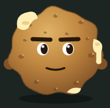
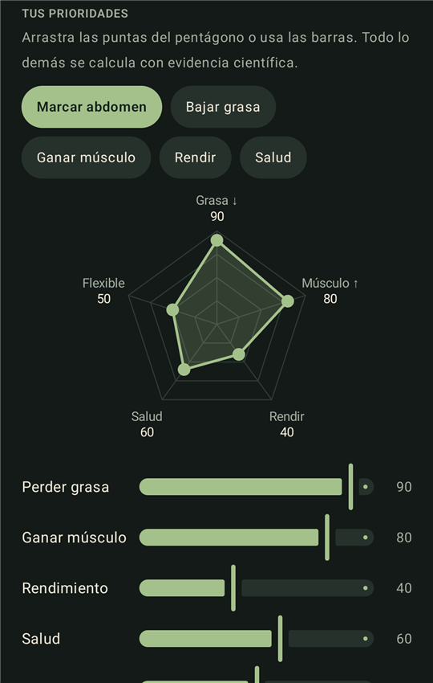
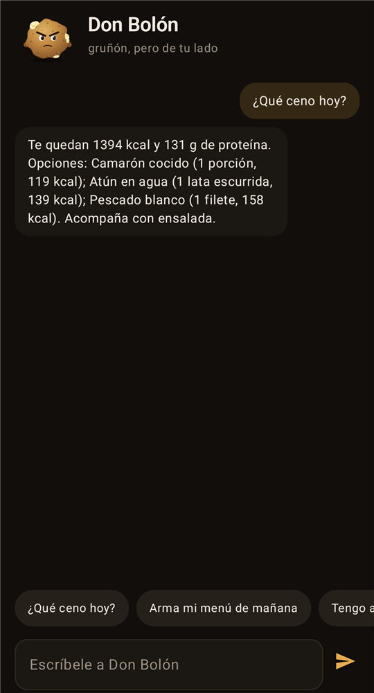
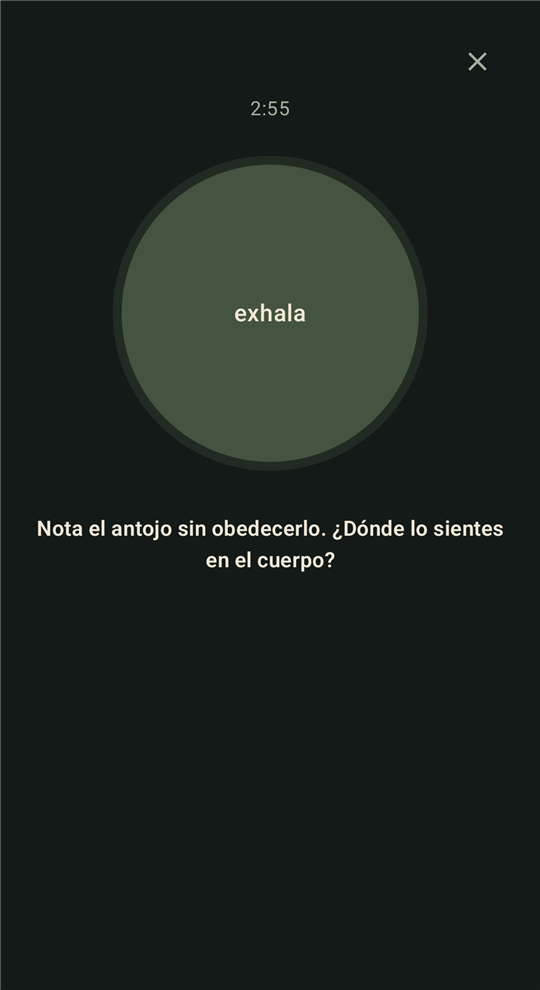

<p align="center">
  
</p>

<h1 align="center">Don Bolón</h1>

<p align="center">
  <b>Le tomas foto a tu plato. Él te dice la verdad.</b><br/>
  Un coach de nutrición con IA, basado en ciencia, con la cara de un bolón de queso muy gruñón.
</p>

<p align="center">
  
  
  
  
</p>

---

Don Bolón es una app Android para **comer con consciencia todos los días**: registra lo que comes con una foto, calcula tus calorías y macros con fórmulas publicadas, te arma un menú ecuatoriano que cuadra con tus metas y te acompaña en la parte difícil, que no es saber qué comer sino **hacerlo con constancia**.

Él gruñe contra los hábitos, nunca contra ti. No hay culpa, no hay vergüenza y no hay dietas extremas.

<p align="center">
  
  &nbsp;
  
  &nbsp;
  
</p>

## Lo que hace

| | |
|---|---|
| 📷 **Foto primero** | Tocas **+**, tomas la foto y el análisis arranca solo. La IA separa cada ingrediente, estima gramos, cuenta el aceite oculto y comprueba que `kcal ≈ 4·P + 4·C + 9·G`. Solo si algo que la foto no muestra cambia las calorías (¿frito o a la plancha?), te hace **una** pregunta y corrige. |
| ✍️ **O descríbelo** | "120 g de verde majado, 1 huevo frito, café con leche" también funciona, con IA o sin ella, gracias a una libreta offline con comida ecuatoriana (bolón, encebollado, seco, menestra, ceviche…). |
| ⬠ **Metas en un pentágono** | Perder grasa, ganar músculo, rendimiento, salud y flexibilidad, de 0 a 100. Arrastras las puntas y todo se recalcula: calorías, proteína, grasa, fibra, margen libre, días de fuerza y cardio. |
| 🍽️ **¿Qué como ahora?** | Una idea para tu próxima comida, ya cuadrada con lo que te queda del día. "Lo comí" la registra con un toque; "Otra idea" propone otra. |
| ✅ **Constancia** | Cuatro hábitos diarios (registré, proteína, entrené, agua), racha hacia los 66 días de un hábito y peso suavizado para ver la tendencia real, no el agua del día. |
| 🧀 **Don Bolón te lo dice** | La ciencia no está pegada en la pantalla: él la trae cuando viene al caso (poca proteína, te pasaste, comiste por estrés, no has entrenado…). Toca su globo para ver el estudio, tócalo a él para hablarle. Si comiste sin hambre, te ofrece un SOS de 3 minutos para surfear el antojo. |
| 🎨 **Personaje vivo** | Respira, parpadea, se le escurre el queso, frunce el ceño, echa vapor cuando te pasas y se sonroja (a escondidas) cuando cumples. Si lo tocas, gruñe. |

## La ciencia detrás de cada número

Nada es inventado. Don Bolón las cita cuando te da un consejo, y están en **Perfil → ¿Por qué estos números?**.

| Qué | Cómo se calcula | Fuente |
|---|---|---|
| Gasto en reposo | Mifflin–St Jeor | Mifflin et al. (1990); Frankenfield et al. (2005) |
| Gasto diario | × factor de actividad | FAO/OMS/UNU |
| Déficit o superávit | Grasa pura → −25 %, músculo puro → +10 %, ambos (recomposición) → ≈ −12 %; rendimiento suaviza el déficit hasta 30 % | Helms et al. (2014); Iraki et al. (2019); Barakat et al. (2020); Mountjoy et al. (2018) |
| Límites de seguridad | Déficit ≤ 1 % del peso/semana, superávit ≤ 1,5 %/mes, nunca menos de 1500/1200 kcal | Helms et al. (2014) |
| Proteína | 1,2–2,4 g/kg según prioridades | Morton et al. (2018); Jäger et al. (2017, ISSN) |
| Fibra | ≥ 14 g/1000 kcal y ≥ 25–30 g | Reynolds et al. (2019, The Lancet) |
| Fuerza y cardio | Cada músculo ≥ 2 veces/semana; 150 min de cardio | Schoenfeld et al. (2016); OMS (2020) |
| Registrar | La constancia predice el resultado más que la precisión | Burke et al. (2011) |
| Hábitos | ~66 días para que algo sea automático | Lally et al. (2010) |
| Planes Si-Entonces | Duplican la probabilidad de cumplir | Gollwitzer & Sheeran (2006) |
| Restricción flexible | Menos atracones que las reglas de todo-o-nada | Westenhoefer et al. (1999) |
| Después de un desliz | Autocompasión, sin compensar | Adams & Leary (2007) |
| Antojos | Surfear la ola en vez de pelearla | Bowen & Marlatt (2009) |

## Privacidad y seguridad

- **Tu diario no sale del teléfono.** Se guarda cifrado con AES-256-GCM y una llave que vive en el Android Keystore. La app desactiva el respaldo en la nube y la transferencia entre dispositivos.
- **Tu llave de IA es tuya.** Se escribe dentro de la app y se guarda cifrada igual que el diario. Este repositorio no contiene ninguna llave, token ni dato personal.
- **Solo HTTPS.** El tráfico sin cifrar está bloqueado. Lo único que se envía, y solo cuando tú pides un análisis, es la foto y tu descripción al proveedor que elegiste (Google Gemini o Anthropic Claude).
- **Bloqueo opcional** con huella, cara o PIN.
- **Sin IA también funciona:** la libreta offline, el menú y el coach responden con los datos locales.

## Cómo usarla

1. Compila e instala:
   ```bash
   ./gradlew :app:installDebug
   ```
2. Abre la app, llena tus datos y elige tus prioridades.
3. En **Perfil → Inteligencia artificial**, pega tu llave de [Google AI Studio](https://aistudio.google.com/apikey) o de [Anthropic](https://console.anthropic.com/). Sin llave, la app usa la libreta offline.

Requisitos para compilar: JDK 17 y Android SDK 36. Funciona en Android 9 o superior.

## Hecho con

Kotlin · Jetpack Compose · Material 3 · Android Keystore · BiometricPrompt · Gemini API · Anthropic Java SDK. El personaje está dibujado a mano en un `Canvas` de Compose, sin imágenes.

---

<sub>Don Bolón es una guía educativa y no reemplaza a un médico o nutricionista. Si tienes una condición médica, estás embarazada o tienes historial de trastornos alimentarios, consulta a un profesional.</sub>
