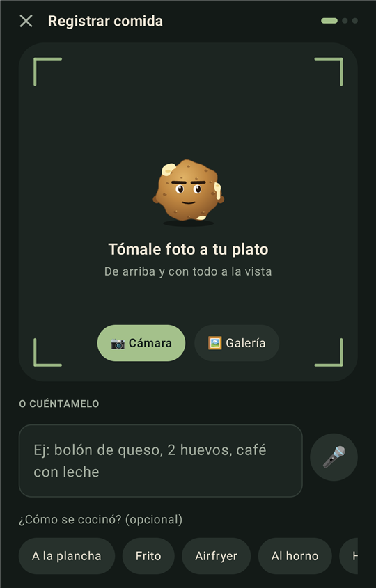
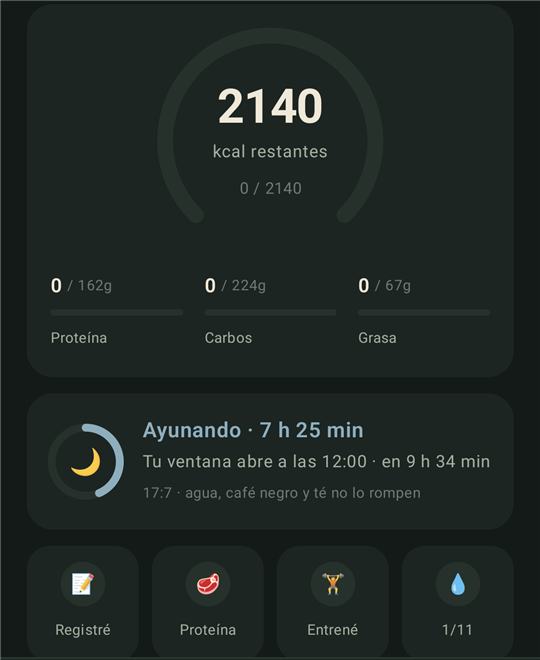
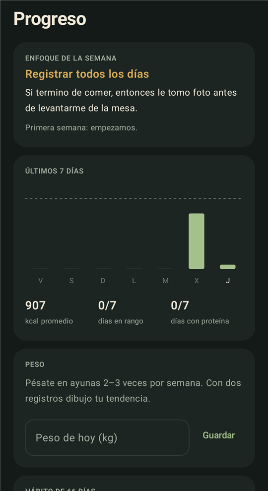

<p align="center">
  
</p>

<h1 align="center">Don Bolón</h1>

<p align="center">
  <b>Snap your plate. He tells you the truth.</b><br/>
  An AI nutrition coach for Android, built on published science, with the face of a very grumpy <i>bolón de queso</i>.
</p>

<p align="center">
  
  
  
  
  
</p>

<p align="center">
  <a href="#-what-it-does">Features</a> ·
  <a href="#-the-science-behind-every-number">Science</a> ·
  <a href="#-privacy-and-security">Privacy</a> ·
  <a href="#-get-started">Get started</a>
</p>

---

Most diet apps fail at the same place: not at knowing *what* to eat, but at **doing it consistently**. Don Bolón is built for that part. Take a photo of your food and the AI splits it into ingredients, weighs each one against the real size of your plate and gives you calories and macros in seconds. Your targets come from peer-reviewed formulas, not guesses, and a grumpy little cheese ball keeps you honest every day.

He growls at habits, never at you. No guilt, no shame, no crash diets.

> **What's a bolón?** A ball of mashed green plantain stuffed with cheese, fried or baked: breakfast royalty in Ecuador. Grumpy, dense and secretly warm inside, just like your coach.

<p align="center">
  
  &nbsp;
  
  &nbsp;
  
  &nbsp;
  
</p>
<p align="center"><sub>Log · Today · Progress · Goals</sub></p>

## ✨ What it does

| | |
|---|---|
| 📷 **Photo first** | Tap **+**, take the picture and the analysis starts by itself. The AI separates every ingredient, estimates grams, counts hidden oil and checks that `kcal ≈ 4·P + 4·C + 9·F`. Only when something the photo can't show changes the calories (fried or grilled?) does it ask you **one** question and correct itself. |
| 🍽️ **Your real plates** | Save the size of your own plates, bowls and glasses, and pick the one you used when logging. The AI uses it as a ruler for every portion, because photo-only estimates are off by 17–48% on average. |
| 🎤 **Or just say it** | Describe your meal by voice or text and the AI analyzes it too. Repeat a recent meal in one tap and fine-tune each portion with a slider. No connection? An offline food notebook has your back. |
| ⬠ **Goals as a pentagon** | Lose fat, build muscle, performance, health and flexibility, each from 0 to 100. Drag the corners and everything is recalculated: calories, protein, fat, fiber, a flexible margin, strength and cardio days. |
| 📈 **Your curve** | Your real weight trend without the daily water noise, where you're heading at your current intake and when you'll reach your goal. The projection flattens the way real bodies do (Hall et al., 2011). Scrub it with a finger, switch to **waist** or **estimated fat lost**, and see your week and a 10-week color calendar. |
| 🌙 **Intermittent fasting** | Set any eating window you like, or let the app **suggest one from the research**: close it 3 h before bed (Vujović et al., 2022), keep it 8–10 h long and start it when you already tend to eat. Includes a live countdown, meal ideas only inside your window, and a coach who won't nag you for not eating while you fast. |
| 🍳 **What should I eat now?** | One idea for your next meal, already sized to what's left of your day. "I ate it" logs it in one tap; "Another idea" swaps it. |
| 🧠 **Memory** | Don Bolón remembers what you tell him (tastes, schedule, what's hard for you), learns your real portions every time you correct the AI, and every Monday picks **one focus** for the week from your weakest habit, with an if-then plan. You can see and delete everything he knows in your profile. |
| 🔔 **Reminders** | Water every 2 hours, only when you're behind, with an "I had one" button right in the notification, plus alerts when your eating window opens and an hour before it closes. |
| ✅ **Consistency** | Four daily habits (logged, protein, trained, water) and a streak toward the 66 days it takes for a habit to become automatic. |
| 🧀 **He tells you, in context** | More than 20 findings from studies checked one by one (sleep, late eating, ultra-processed food, soup before lunch, protein…), told in his own voice with the real number from the paper. They're not stuck on the screen: he brings each one up when it matters. Tap his bubble to see the study. Ate without being hungry? He offers a 3-minute SOS to ride out the craving. |
| 🎨 **A character, not a chart** | He breathes, blinks and his cheese drips. Tap him and he growls, hops, laughs or chews; stroke him and he blushes; drag him and he squishes like dough while his eyes follow your finger. His mood follows your day: happy when you hit your targets, calm most of the time, grumpy only when something needs fixing. |
| 🔑 **AI in one paste** | Paste your key and he's ready: no buttons to hunt for. Works with Google's new `AQ.` keys and the classic `AIza` ones, finds the model that answers and remembers it. If a key ever stops working, he tells you right where you were logging, without losing what you wrote. |

## 🔬 The science behind every number

Nothing is made up. Every target is computed from a published method, and the app shows you why under **Profile → Why these numbers?**

| What | How | Source |
|---|---|---|
| Resting energy | Mifflin–St Jeor | Mifflin et al. (1990); Frankenfield et al. (2005) |
| Daily energy | × activity factor | FAO/WHO/UNU |
| Deficit or surplus | Pure fat loss → −25%, pure muscle → +10%, both (recomposition) → ≈ −12%; performance softens the deficit up to 30% | Helms et al. (2014); Iraki et al. (2019); Barakat et al. (2020); Mountjoy et al. (2018) |
| Safety limits | Loss ≤ 1% of body weight per week, gain ≤ 1.5% per month, never below 1500/1200 kcal | Helms et al. (2014) |
| Protein | 1.2–2.4 g/kg depending on your priorities | Morton et al. (2018); Jäger et al. (2017, ISSN) |
| Fiber | ≥ 14 g per 1000 kcal and ≥ 25–30 g | Reynolds et al. (2019), The Lancet |
| Strength and cardio | Each muscle ≥ 2×/week; 150 min of cardio | Schoenfeld et al. (2016); WHO (2020) |
| Weight projection | Energy needs recalculated each week at your new weight, so the curve flattens | Hall et al. (2011), The Lancet |
| Logging | Consistency predicts results better than precision | Burke et al. (2011) |
| Habits | ~66 days for a behavior to become automatic | Lally et al. (2010) |
| If-then plans | Medium-to-large effect on reaching goals (d ≈ 0.65, 94 studies) | Gollwitzer & Sheeran (2006) |
| Flexible restraint | Fewer binges than all-or-nothing rules | Westenhoefer et al. (1999) |
| After a slip | Self-compassion, no compensating | Adams & Leary (2007) |
| Cravings | Surf the urge instead of fighting it | Bowen & Marlatt (2009) |
| Short sleep | ~385 extra kcal a day with no extra burn | Al Khatib et al. (2018), Eur J Clin Nutr |
| Late eating | More hunger and lower expenditure on the same calories | Vujović et al. (2022), Cell Metabolism |
| Ultra-processed food | 508 extra kcal a day when eating freely | Hall et al. (2019), Cell Metabolism |
| Soup first | 20% less energy eaten at lunch | Flood & Rolls (2007), Appetite |
| Slow loss | 0.7% of body weight per week kept and built muscle in athletes | Garthe et al. (2011), IJSNEM |
| Diet breaks | More fat lost alternating 2 weeks of diet with 2 of maintenance | Byrne et al. (2018), Int J Obesity |
| Muscle in a deficit | With 2.4 g/kg protein and lifting, people gained muscle while losing fat | Longland et al. (2016), Am J Clin Nutr |

## 🎨 Colors with a purpose

A dark, vintage palette where every color has a job, chosen from research on color and eating:

| Color | Where | Why |
|---|---|---|
| Sage green | Background, buttons, actions | Green reads as fresh and healthy (Schuldt, 2013) |
| Mustard | Don Bolón, achievements, protein | Yellows and oranges stimulate appetite (Spence, 2015), so they're used as a reward, never as a background |
| Terracotta | Only when you go over | Red works as a stop signal and reduces snacking (Genschow et al., 2012), softened to inform without scolding |
| Dusty blue | Water and carbs | Calm, and doesn't trigger appetite |

## 🔒 Privacy and security

- **Your diary never leaves your phone.** It's stored encrypted with AES-256-GCM under a key that lives in the Android Keystore. Cloud backup and device-to-device transfer are disabled.
- **Your AI key is yours.** You type it inside the app and it's encrypted just like your diary. Error messages and logs never show it; at most they say how it starts and how long it is. This repository contains no keys, tokens or personal data.
- **HTTPS only.** Cleartext traffic is blocked. The only thing sent anywhere, and only when you ask for an analysis, is your photo and description, to the provider you chose (Google Gemini or Anthropic Claude).
- **Optional lock** with fingerprint, face or PIN.
- **Works without AI too:** the offline notebook, the menu and the coach fall back to local data.

## 🚀 Get started

**Install the app:** download the APK from the [latest release](../../releases/latest) and open it on your Android phone (Android 9 or newer). You may need to allow installs from your browser.

**Or build it yourself:**

```bash
git clone https://github.com/emalvarez3-maker/don-bolon.git
cd don-bolon
./gradlew :app:installDebug
```

Requires JDK 17 and Android SDK 36.

**Connect the AI:** open **Profile → Artificial intelligence** and paste a free key from [Google AI Studio](https://aistudio.google.com/apikey), or one from [Anthropic](https://console.anthropic.com/). It's tested and connected in a few seconds. Without a key, the app uses its offline notebook.

> 🌎 **Language:** the app currently speaks Spanish and knows Latin American food especially well (the AI recognizes dishes from anywhere). An English interface is on the roadmap.

## 🛠️ Built with

Kotlin · Jetpack Compose · Material 3 · Android Keystore · BiometricPrompt · Gemini API · Anthropic Java SDK. The character is drawn by hand on a Compose `Canvas`, with no images, and animated in real time.

---

<sub>Don Bolón is an educational guide and does not replace a doctor or dietitian. If you have a medical condition, are pregnant, or have a history of eating disorders, please talk to a professional.</sub>
